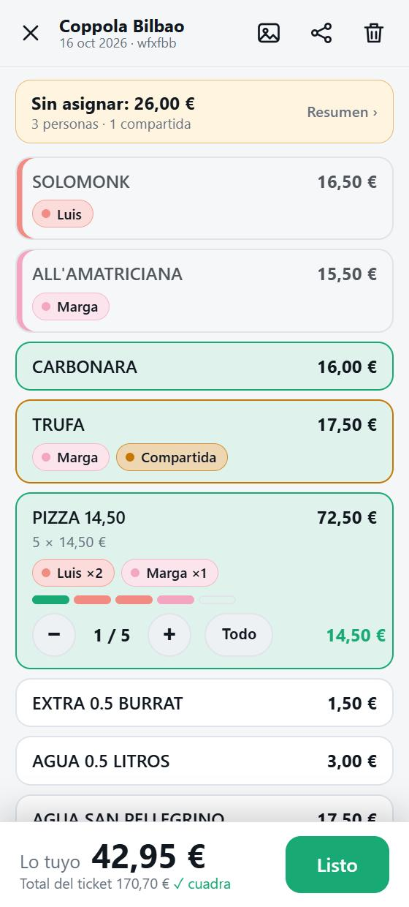
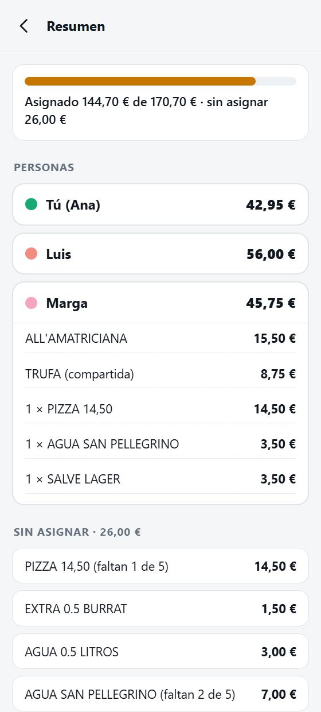
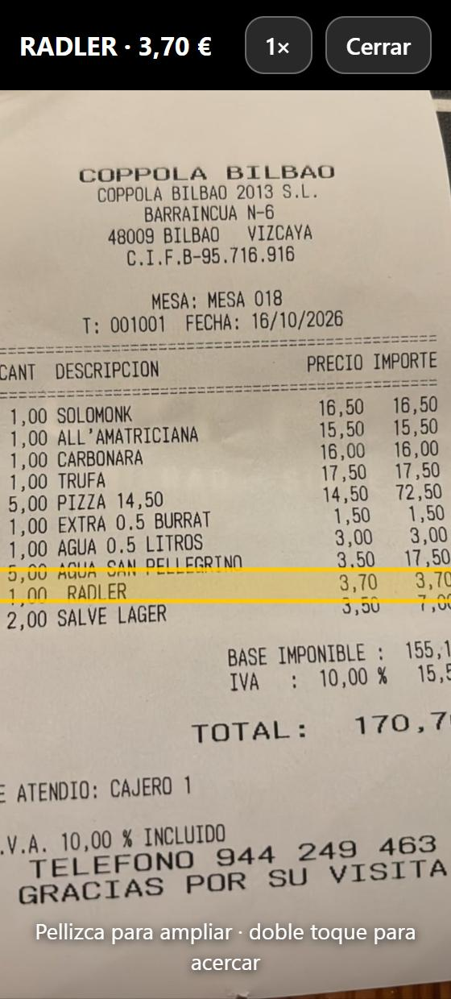
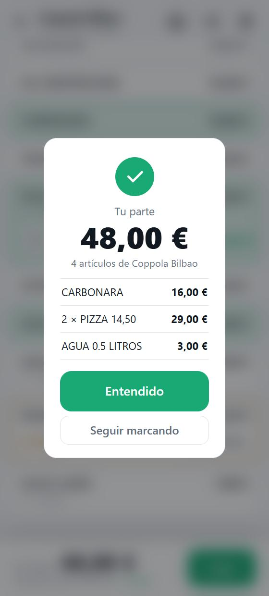
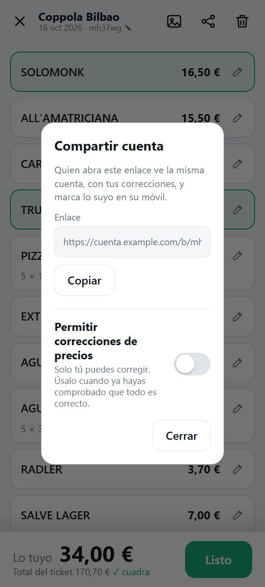

# Cuenta

**v1.0** — Haz una foto al ticket del restaurante, toca lo que es tuyo y suma.

Una web app instalable (PWA) en español, pensada para el móvil. La foto se lee con OCR **en tu propio servidor** (sin servicios de pago ni APIs externas), cada línea se puede marcar para ir sumando lo que te toca pagar, y la cuenta se puede compartir con un enlace para que cada persona marque lo suyo.

## Capturas

<table>
  <tr>
    <td align="center"></td>
    <td align="center"></td>
    <td align="center"></td>
    <td align="center"></td>
    <td align="center"></td>
  </tr>
  <tr>
    <td align="center"><sub><b>Marcar y sumar</b><br>cada persona con su color</sub></td>
    <td align="center"><sub><b>Resumen</b><br>quién tiene qué y qué falta</sub></td>
    <td align="center"><sub><b>Ver en la foto</b><br>para comprobar una línea dudosa</sub></td>
    <td align="center"><sub><b>Tu parte</b><br>al terminar</sub></td>
    <td align="center"><sub><b>Compartir</b><br>y bloquear correcciones</sub></td>
  </tr>
</table>

## Qué hace

- **Foto → líneas.** Al abrir la app sale la cámara; también se puede elegir una foto de la galería o, en Android con la app instalada, compartirla desde la galería. Se leen cantidad, descripción, precio e importe de cada línea, el total, el nombre del local y la fecha.
- **Marcar y sumar.** Tocas una línea y se suma a «Lo tuyo». Las líneas con varias unidades tienen contador (2 de 5 pizzas). El botón «Listo» enseña el resumen de tu parte y avisa si queda algo sin asignar.
- **Varias personas.** Al abrir una cuenta se pide un nombre (se guarda en el móvil y se puede cambiar). Cada persona recibe un color pastel; tú ves lo tuyo siempre en verde y los demás lo ven en tu color. Se ve en cada línea quién la ha marcado (en las de varias unidades, una casilla por unidad), cuánto queda **sin asignar** y, en el **Resumen**, el total y la lista de cada persona. Si dos personas marcan lo mismo, la línea sale como *compartida* y se reparte a partes iguales (o en proporción a las unidades). Los cambios se ven en unos 3 segundos y las marcas hechas sin conexión se envían al volver la red.
- **Comprobación.** Las líneas se suman y se comparan con el total del ticket. Las líneas dudosas salen en ámbar con «Ver en la foto», que abre la foto ampliada y resalta esa fila.
- **Compartir.** Cada cuenta tiene un enlace `/b/<código>`. Quien lo abre ve la misma cuenta y marca lo suyo.
- **Dueño.** Quien hace la foto es el dueño (una clave guardada solo en su móvil). Solo él cambia el nombre y la fecha, decide si los demás pueden corregir líneas y puede quitar las marcas de otra persona si se equivoca. Por defecto la cuenta nace bloqueada, salvo que la lectura no cuadre con el total o tenga líneas dudosas.
- **Sin conexión.** Las cuentas abiertas se guardan en el móvil (líneas y foto) y se pueden consultar sin red.
- **Sin usuarios ni registro.**

## Cómo funciona la lectura

[RapidOCR](https://github.com/RapidAI/RapidOCR) (modelos PaddleOCR sobre onnxruntime, solo CPU, sin PyTorch) detecta y lee los trozos de texto. `app/ocr.py` endereza la foto según el ángulo medio del texto, agrupa los trozos en filas, interpreta `cantidad descripción precio importe`, corrige confusiones típicas (O/0…) y comprueba que `cantidad × precio = importe` y que todo suma el total. Si la foto está girada (de lado o del revés), prueba las otras orientaciones y guarda la foto ya enderezada. Un pequeño diccionario (`app/vocab.py`) corrige despistes del OCR en los nombres ("PaTmera" → "Palmera", "ro11" → "roll"), de forma conservadora: solo palabras de 5+ letras con un único candidato, y nunca añade ni quita letras. Acepta tickets con y sin columna de cantidad, y busca el total aunque "TOTAL" y su importe salgan en filas distintas. Tarda unos 8–10 s por ticket en una CPU de 4 núcleos (hasta ~30 s si hay que girar la foto).


### Segundo lector opcional (IA)

Cuando la suma de las líneas leídas no cuadra con el total (o no se lee nada), Cuenta puede pedir una segunda lectura a un **servicio aparte y privado** que no forma parte de este repositorio. Esta app no guarda ninguna clave ni sale a internet: solo entrega la foto ya reducida a ese servicio, por una red interna de Docker, y recibe las líneas. Si el servicio no está, está apagado, sin saldo o falla, se queda la lectura local.

Se activa con dos variables (por ejemplo en un `.env` junto al `docker-compose.yml`, que no se sube): `CUENTA_AI_URL` (dirección interna del servicio; vacía = solo OCR local) y `CUENTA_AI_SECRET` (secreto compartido). Lo demás (encendido, cuándo usarlo, saldo, avisos) lo decide el servicio.

Contrato del servicio, todo con la cabecera `x-secret`:

| Petición | Qué hace |
|---|---|
| `GET /policy` | `{enabled, mode}`: si está activo y si se usa solo cuando la lectura local no cuadra (`fallback`) o siempre (`always`) |
| `POST /read` | cuerpo `image/jpeg`; responde `{lines:[{qty,name,price,amount}], total, title, date, call_id}` |
| `POST /event` | `{slug, title, total, nlines, local_match, call_id}`: cada cuenta creada, para que el servicio pueda listarlas |
| `/admin-api/*` | ajustes, saldo e historial; solo los llama el panel de `/admin` de Cuenta cuando ya has entrado (el servicio no tiene login propio) |

Con el servicio activo, la pantalla de inicio avisa de que la foto puede enviarse a un servicio de IA. Las líneas leídas así no tienen posición en la foto, así que «Ver en la foto» no resalta la fila.

## Arrancar

```bash
docker compose up -d --build
```

La app queda en `http://localhost:8102`. Los datos (SQLite y fotos) viven en el volumen `cuenta_data`. Para publicarla, ponle delante un proxy inverso con HTTPS (la cámara y la instalación como app lo exigen).

## Panel de administración

La web pública no tiene cuentas de usuario, pero hay un panel privado en **`/admin`** para ver las cuentas subidas y borrarlas. No hay ningún enlace a él: solo lo encuentra quien conoce la dirección.

- **Primera vez:** mientras no haya contraseña, abrir `/admin` equivale a estar dentro y el panel ofrece crearla (mínimo 8 caracteres). También se puede poner por terminal, sin pasarla como argumento: `docker exec -it cuenta python admin_tools.py set-password` (además `status` y `logout-all`).
- **La sesión no caduca:** la cookie (`HttpOnly`, `SameSite=Strict`, `Secure` tras https) se renueva cada vez que entras. Cambiar la contraseña cierra las demás sesiones.
- **Entrada discreta:** la app instalada no tiene barra de direcciones, así que en la lista «Mis cuentas» hay un candado muy tenue abajo a la derecha que lleva a `/admin`. Es igual para todos los visitantes y no cambia con la sesión; no hay ningún otro enlace ni icono en la web.

El panel muestra estadísticas (cuentas, personas, marcas, fotos y base de datos, disco libre, tickets leídos en 24 h), la lista de cuentas con miniatura (se abren y se borran una a una o varias a la vez, con la etiqueta **IA** en las que usaron el lector de pago y un filtro), una limpieza de cuentas sin actividad desde hace N días, un interruptor para **pausar la lectura de tickets**, los últimos eventos de abuso y, si el segundo lector está configurado, su sección (ver abajo).

Protección: contraseña con scrypt (solo se guarda el hash), sesión en el servidor, cabecera `X-Admin` y comprobación de origen en los cambios (CSRF), y límite de intentos (5 por 10 min y por IP, 30 por hora en total). Con el panel sin contraseña no se puede tocar el lector IA.

## Estructura

| | |
|---|---|
| `app/main.py` | FastAPI: página, `/api/scan`, API de cuentas, límites |
| `app/ocr.py` | OCR y reconstrucción de las líneas |
| `app/vocab.py` | Diccionario para corregir erratas del OCR en los nombres |
| `app/store.py` | SQLite + fotos, personas y marcas, dueño y permisos |
| `app/admin.py`, `admin_tools.py` | Panel de administración y su herramienta de línea de comandos |
| `app/limits.py` | Límites contra abusos |
| `app/static/` | Interfaz (JS/CSS sin dependencias), service worker, manifest |

## Notas de seguridad

La app es **pública y sin login** a propósito. Quien tenga el enlace de una cuenta puede verla; las cuentas y sus fotos no se borran solas. Lo que la protege:

- **Abuso:** máximo 20 escaneos por hora y por IP (en IPv6 se cuenta el prefijo /64, no la dirección suelta), un ticket a la vez por visitante, cola corta, tope diario de tickets para todo el servicio (`CUENTA_MAX_SCANS_DAY`, 200 por defecto; 0 pausa la lectura), no se aceptan tickets si queda poco disco, 12 MB por foto y 64 KB por petición de la API (rechazo temprano por tamaño), 120 cambios por minuto y 30 búsquedas fallidas por 5 min (los enlaces no se pueden enumerar). Solo se guarda una foto si la lectura encuentra líneas de ticket, y se reconvierte a JPEG (sin metadatos). Los abusos quedan en el log como `[abuse]`.
- **Imágenes:** límite de píxeles contra imágenes «bomba» y de memoria del contenedor.
- **Permisos:** la regla del dueño y la identidad de cada persona (una clave secreta por dispositivo, guardada solo como hash) se aplican en el servidor: nadie puede marcar ni desmarcar por otro. Los nombres y las marcas los ve quien tenga el enlace.
- **Integridad:** las correcciones se hacen por línea y dentro de una transacción con bloqueo, así que dos personas corrigiendo a la vez no se pisan.
- **Navegador:** cabeceras CSP, `no-store` en la API, sin `innerHTML` con datos de usuario.
- **Contenedor:** sistema de archivos de solo lectura, sin capacidades, sin DNS (la lectura es local y no necesita internet; también evita la telemetría de onnxruntime, desactivada además por código), límites de CPU, memoria y procesos, y el OCR con 2 hilos y prioridad baja para no molestar a otros servicios del servidor.
